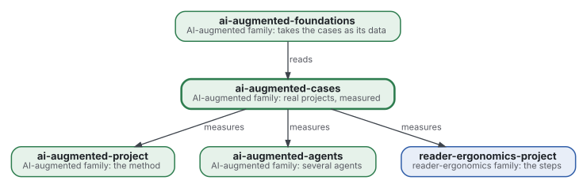
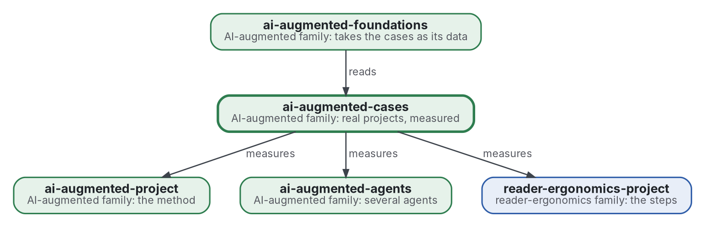

# Cas de travail augmenté par l'IA

[](https://github.com/Tewf/ai-augmented-cases/actions/workflows/checks.yml)
[](https://tewf.github.io/ai-augmented-cases/)

Les preuves de la famille : un **cas** par projet réel mené avec la méthode, disant ce qu'il a coûté et produit.
Allers-retours, temps, où chaque erreur a été attrapée (par une vérification, par le modèle, par la personne), quelles
décisions sont parvenues à la personne et combien de fois la même. Les autres membres disent comment travailler ;
celui-ci consigne ce qui s'est passé quand quelqu'un l'a fait.

Cette page en anglais : [README.md](README.md). Les deux versions suivent le même état.

> **État (2026-11-02) :** mis en place ; rien n'est encore écrit au-delà du périmètre. Le premier travail est une revue
> de littérature sur la façon d'écrire un cas pour qu'on puisse s'y fier, non commencée ; le premier cas sera la journée
> où six dépôts ont été bâtis à la fois, le 2026-10-29. Le nom est provisoire. Ce n'est ni une norme officielle, ni une
> étude relue par des pairs, ni un résultat nouveau.
>
> **Comment il est fait :** avec Claude, un assistant IA d'Anthropic, sous la direction du mainteneur, comme
> reader-ergonomics. Les corrections sont bienvenues sous forme d'issues.

## Où il se place



<details>
<summary>Graphviz source</summary>



</details>

- **Il mesure les membres :** un cas nomme la version de la méthode avec laquelle il a été mené, par commit.
- **Il obéit à [reader-ergonomics](https://github.com/Tewf/reader-ergonomics/blob/b9732b9814c71768f722691f3c5049ec2b8ed378/standard.md)** (v1.19.2) et exécute ses vérifications en CI.
- **Il ne pointe que vers le bas.** [ai-augmented-foundations](https://github.com/Tewf/ai-augmented-foundations) lit les cas ;
  aucun cas n'en dépend. La carte de la famille est [ai-augmented](https://github.com/Tewf/ai-augmented).

## Périmètre

| | Quoi | Pourquoi |
|---|---|---|
| dedans | un rapport par projet : ce qui a été demandé, mené, produit, et ce que cela a coûté | les affirmations de la famille sur sa méthode reposent là-dessus, ou sur rien |
| dedans | les mesures : allers-retours, temps, où les erreurs ont été attrapées, décisions parvenues à la personne, faits écrits deux fois | ce que la méthode promet de réduire doit être compté |
| dedans | des mesures qu'un programme prend dans le seul historique d'un dépôt, pour qu'un cas se rejoue | un compte à la main est une affirmation ; un compte par programme est une vérification |
| dedans | la forme d'un cas, pour qu'un lecteur absent puisse s'y fier | un cas écrit après coup, par l'un de ses agents, a besoin de règles |
| dehors | la théorie du pourquoi | [ai-augmented-foundations](https://github.com/Tewf/ai-augmented-foundations) |
| dehors | la méthode elle-même | [ai-augmented-project](https://github.com/Tewf/ai-augmented-project), [reader-ergonomics-project](https://github.com/Tewf/reader-ergonomics-project) |
| dehors | un cas au sujet confidentiel | il reste privé ; seules ses mesures peuvent être rapportées |

## Le premier travail : une revue de littérature

Non commencée. Elle suit l'ordre d'une revue de thèse, et elle est finie quand elle peut nommer la référence.

1. **Cadrer :** comment le domaine nomme un rapport sur un projet réel, écrit par ses participants, avec des nombres.
   Pistes à vérifier : étude de cas en génie logiciel, rapports d'expérience, post-mortems et rétrospectives, fouille des
   dépôts logiciels. Le dépôt peut être renommé alors.
2. **Revue :** chaque nom, cherché par son nom académique, son acronyme et son auteur ; les synthèses d'abord.
   - les guides de l'étude de cas et du rapport d'expérience : ce qui rend l'un fiable ;
   - ce qui a été mesuré sur des personnes travaillant avec des agents de code, et comment ;
   - les mesures prises dans le seul historique de version, et leurs biais connus ;
   - les post-mortems comme littérature grise : ce que la pratique consigne, et ce qu'elle omet.
3. **État de l'art, et le dossier contre.**
4. **Positionnement :** ce que ce dépôt demande et que le domaine ne répond pas déjà.
5. **Référence :** le guide publié d'étude de cas qu'un rapport ici doit respecter, nommé, et le premier cas écrit contre lui.

## Questions auxquelles la revue doit répondre

- **Dans le seul historique.** Lesquelles des mesures ci-dessus un programme peut-il prendre dans l'historique d'un
  dépôt, avec quel biais ?
- **Confiance.** Comment un cas écrit par l'un de ses propres agents devient-il fiable pour un lecteur absent : ce qui
  est cité, compté, laissé de côté et dit tel ?
- **Le premier cas.** Ce que la journée du 2026-10-29 a coûté et produit : six dépôts, une session coordinatrice, les
  questions parvenues à la personne, les faits écrits deux fois et trouvés.
- **Comparaison.** À quoi un cas se compare-t-il : le même projet sans la méthode, ou les cas antérieurs de la méthode ?

## Vérifier

```sh
git clone https://github.com/Tewf/reader-ergonomics
python3 reader-ergonomics/checks/run.py chemin/vers/ce/depot
```

La CI exécute les mêmes vérifications à chaque push, et une exécution échoue à la première erreur
([checks.yml](https://github.com/Tewf/ai-augmented-cases/blob/master/.github/workflows/checks.yml)). Chaque push sur
master construit aussi le site, [tewf.github.io/ai-augmented-cases](https://tewf.github.io/ai-augmented-cases/)
([pages.yml](https://github.com/Tewf/ai-augmented-cases/blob/master/.github/workflows/pages.yml)).

## Contenu

| Partie | Résumé |
|---|---|
| [decisions](decisions/) | une fiche par choix qui façonne ce dépôt, chacune ouvrant sur la décision en une phrase |

## Licence

Code sous [Apache License 2.0](LICENSE) ; prose sous [CC BY 4.0](LICENSES/CC-BY-4.0.txt). Réutilisez-le comme vous le
souhaitez, en créditant ce dépôt ; [CITATION.cff](CITATION.cff) donne une citation si besoin.
