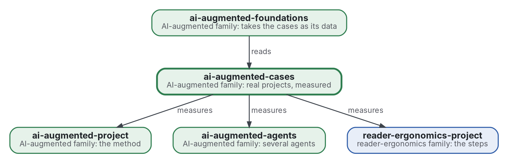

# Cas de travail augmenté par l'IA

[](https://github.com/Tewf/ai-augmented-cases/actions/workflows/checks.yml)
[](https://tewf.github.io/ai-augmented-cases/)

Les preuves de la famille : un **cas** par projet réel mené avec la méthode, disant ce qu'il a coûté et produit.
Allers-retours, temps, où chaque erreur a été attrapée (par une vérification, par le modèle, par la personne), quelles
décisions sont parvenues à la personne et combien de fois la même. Les autres membres disent comment travailler ;
celui-ci consigne ce qui s'est passé quand quelqu'un l'a fait.

Cette page en anglais : [README.md](README.md). Les deux versions suivent le même état.

> **État (2026-11-02) :** la première revue est écrite (une première passe, 37 sources) et nomme sa référence ; deux cas
> sont écrits avec un programme qui prend leurs comptes : la journée où six dépôts ont été bâtis à la fois, le
> 2026-10-29, et la nuit où huit dépôts ont reçu leur premier travail, le 2026-11-02. Le nom reste provisoire. Ce n'est ni une norme officielle, ni une étude relue par des pairs, ni un résultat
> nouveau.
>
> **Comment il est fait :** avec Claude, un assistant IA d'Anthropic, sous la direction du mainteneur, comme
> reader-ergonomics. Les corrections sont bienvenues sous forme d'issues.

## Où il se place


<details>
<summary>Graphviz source</summary>



</details>

- **Il mesure les membres :** un cas nomme la version de la méthode avec laquelle il a été mené, par commit, et dit si
  le raisonnement est passé par [reader-ergonomics-blueprint](https://github.com/Tewf/reader-ergonomics-blueprint), le pont.
- **Il obéit à [reader-ergonomics](https://github.com/Tewf/reader-ergonomics/blob/b9732b9814c71768f722691f3c5049ec2b8ed378/standard.md)** (v1.19.2) et exécute ses vérifications en CI.
- **Il ne pointe que vers le bas.** [ai-augmented-foundations](https://github.com/Tewf/ai-augmented-foundations) lit les cas ;
  aucun cas n'en dépend. La carte de la famille est [ai-augmented](https://github.com/Tewf/ai-augmented).

## Périmètre

| | Quoi | Pourquoi |
|---|---|---|
| dedans | un rapport par projet : ce qui a été demandé, mené, produit, et ce que cela a coûté | les affirmations de la famille sur sa méthode reposent là-dessus, ou sur rien |
| dedans | les mesures : allers-retours, temps, où les erreurs ont été attrapées, décisions parvenues à la personne, faits écrits deux fois | ce que la méthode promet de réduire doit être compté |
| dedans | des mesures qu'un programme prend dans le seul historique d'un dépôt, pour qu'un cas se rejoue | un compte à la main est une affirmation ; un compte par programme est une vérification |
| dedans | la forme d'un cas, pour qu'un lecteur absent puisse s'y fier | un cas écrit après coup, par l'un de ses agents, a besoin de règles |
| dehors | la théorie du pourquoi | [ai-augmented-foundations](https://github.com/Tewf/ai-augmented-foundations) |
| dehors | la méthode elle-même | [ai-augmented-project](https://github.com/Tewf/ai-augmented-project), [reader-ergonomics-project](https://github.com/Tewf/reader-ergonomics-project) |
| dehors | un cas au sujet confidentiel | il reste privé ; seules ses mesures peuvent être rapportées |

## Ce que la revue a trouvé

La revue est dans [evidence/case-reports](evidence/case-reports/) (en anglais) : 37 sources, 29 formelles et 8 grises, en cinq étapes.

- **Le nom du domaine diffère du nôtre.** Un rapport écrit par ceux qui ont participé est un **rapport d'expérience**, pas une étude de cas : la norme communautaire de l'étude de cas l'exclut. Un cas ici est un rapport d'expérience avec des mesures de dépôt, et le dit ([cadrage](evidence/case-reports/frame.md)).
- **Un historique trompe de façons connues.** Un dépôt n'est pas un projet, les commits se déplacent et se réécrivent, et les gros commits n'ont pas la même intention. Dans le premier cas, 434 commits additionnés sur sept dépôts font 415 commits distincts, et 50 étiquettes font 6 publications sur l'hébergeur.
- **Aucune étude ne compte ce que ce dépôt demande.** Les études sur les agents de code mesurent surtout une tâche, une demande de fusion ou un projet. Les récits d'entreprises donnent sessions et coût. Aucune de la sélection ne compte les questions parvenues à une personne en une journée.
- **La confiance repose sur la convention.** Les guides sont bâtis sur d'autres guides et sur l'expérience ; aucune étude ne montre qu'une liste de contrôle rend un cas plus crédible. Le point faible de la liste pour un rapport de l'intérieur est la triangulation.

## La référence

La liste de contrôle du lecteur de Runeson 2009, 12 points, lue avec les critères du rapport d'expérience d'ICSE 2003 et les normes d'étude de cas et de fouille de dépôts. Un cas répond à chaque point, tenu ou non avec une raison, et un programme prend tous les comptes qu'il peut ; un compte à la main est signalé ([référence](evidence/case-reports/baseline.md), [fiche 0002](decisions/0002-a-case-meets-the-readers-checklist.md)).

## Questions auxquelles la revue a répondu

- **Dans le seul historique.** Un programme peut prendre commits, fichiers, étiquettes et fiches de décision par jour. Il ne peut pas prendre les questions parvenues à la personne, ni distinguer un commit d'une unité de travail.
- **Confiance.** Ce qui est cité, compté et laissé de côté est dit dans le cas ; sa forme est [shapes/case.md](shapes/case.md).
- **Le premier cas.** [La journée du 2026-10-29](cases/2026-10-29-family-night/README.md) : 434 commits, 50 étiquettes, 47 fiches ; 16 décisions sont parvenues à la personne, comptées à la main.
- **Comparaison.** Il n'y a pas de témoin. Un cas se compare aux cas antérieurs de la méthode et à un contraste interne au cas ; le premier cas n'a pas d'antérieur, et le second ne se compare à lui que par nature.
- **Le second cas.** [La nuit du 2026-11-02](cases/2026-11-02-eight-first-jobs/README.md) : 33 commits sur huit dépôts, 16 fiches, aucune étiquette.
  6 décisions sont parvenues à la personne, comptées à la main, et 5 sessions ont calé sur un changement de réseau. Le programme ne peut compter ni les messages de la personne, ni les calages, ni les retours, ni les poussées.

## Vérifier

```sh
git clone https://github.com/Tewf/reader-ergonomics
python3 reader-ergonomics/checks/run.py chemin/vers/ce/depot
```

La CI exécute les mêmes vérifications à chaque push, et une exécution échoue à la première erreur
([checks.yml](https://github.com/Tewf/ai-augmented-cases/blob/master/.github/workflows/checks.yml)). Chaque push sur
master construit aussi le site, [tewf.github.io/ai-augmented-cases](https://tewf.github.io/ai-augmented-cases/)
([pages.yml](https://github.com/Tewf/ai-augmented-cases/blob/master/.github/workflows/pages.yml)).

## Contenu

| Partie | Résumé |
|---|---|
| [evidence](evidence/) | la revue derrière ce dépôt et sa bibliographie |
| [shapes](shapes/) | la forme d'un cas, tirée de la référence |
| [cases](cases/) | un dossier par projet réel : le rapport, le programme qui prend ses comptes, et les nombres de son exécution |
| [decisions](decisions/) | une fiche par choix qui façonne ce dépôt, chacune ouvrant sur la décision en une phrase |

## Licence

Code sous [Apache License 2.0](LICENSE) ; prose sous [CC BY 4.0](LICENSES/CC-BY-4.0.txt). Réutilisez-le comme vous le
souhaitez, en créditant ce dépôt ; [CITATION.cff](CITATION.cff) donne une citation si besoin.
