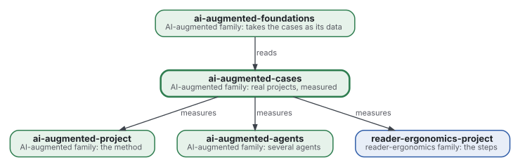
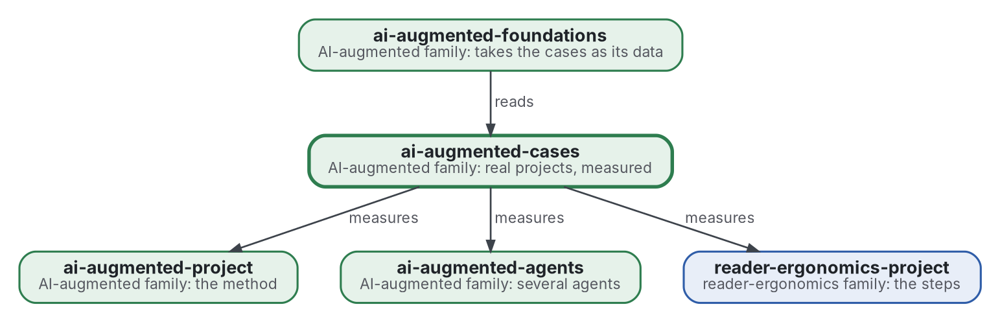

# AI-augmented cases

[](https://github.com/Tewf/ai-augmented-cases/actions/workflows/checks.yml)
[](https://tewf.github.io/ai-augmented-cases/)

The evidence of the family: one **case** per real project run with the method, saying what it cost and what it
produced. Round trips, time, where each error was caught (by a check, by the model, by the person), which decisions
reached the person and how many times the same one did. The other members say how to work; this one records what
happened when someone did.

This page in French: [README.fr.md](README.fr.md).

> **Status (2026-11-02):** set up; nothing is written yet beyond the scope. The first job is a literature review of
> how a case is written so that it can be trusted, not started; the first case will be the day six repositories were
> built at once, 2026-10-29. The name is provisional. It is not an official standard, not a peer-reviewed study and
> not a new result.
>
> **How it is made:** with Claude, an AI assistant by Anthropic, under the maintainer's direction, the way
> reader-ergonomics was made. Corrections are welcome as issues.

## Where it sits



<details>
<summary>Graphviz source</summary>



</details>

- **It measures the members:** a case names the version of the method it was run with, by commit, and says whether
  the reasoning went through [reader-ergonomics-blueprint](https://github.com/Tewf/reader-ergonomics-blueprint), the bridge.
- **It obeys [reader-ergonomics](https://github.com/Tewf/reader-ergonomics/blob/b9732b9814c71768f722691f3c5049ec2b8ed378/standard.md)** (v1.19.2) and runs its checks in CI.
- **It links down only.** [ai-augmented-foundations](https://github.com/Tewf/ai-augmented-foundations) reads the cases; no
  case depends on it. The family's map is [ai-augmented](https://github.com/Tewf/ai-augmented).

## Scope

| | What | Why |
|---|---|---|
| in | one report per project: what was asked, what was run, what came out, what it cost | the family's claims about its method rest on these, or on nothing |
| in | the measures: round trips, time, where errors were caught, decisions that reached the person, facts written twice | what the method promises to cut must be counted |
| in | measures a program takes from a repository's history alone, so that a case can be rerun | a count by hand is a claim; a count by a program is a check |
| in | the shape of a case, so that a reader who was absent can trust it | a case written after the fact, by one of its agents, needs rules |
| out | the theory of why | [ai-augmented-foundations](https://github.com/Tewf/ai-augmented-foundations) |
| out | the method itself | [ai-augmented-project](https://github.com/Tewf/ai-augmented-project), [reader-ergonomics-project](https://github.com/Tewf/reader-ergonomics-project) |
| out | a case with a confidential subject | it stays private; only its measures may be reported |

## The first job: a literature review

Not started. It follows the order of a thesis review, and it is finished when it can name the baseline.

1. **Frame:** what the field calls a report on one real project, written by its participants, with numbers. Leads to
   verify: case study research in software engineering, experience reports, post-mortems and retrospectives, mining
   software repositories. The repository may be renamed then.
2. **Review:** each name, searched by its academic name, its acronym and its author; surveys first.
   - guidelines for case study research and for experience reports: what makes one trustworthy;
   - what has been measured about people working with coding agents, and how;
   - measures taken from version-control history alone, and their known biases;
   - post-mortems as grey literature: what practice records, and what it omits.
3. **State of the art, and the case against.**
4. **Position:** what this repository asks that the field does not already answer.
5. **Baseline:** the published guideline for a case study a report here must meet, named, and the first case written
   against it.

## Questions the review must answer

- **From the history alone.** Which of the measures above can a program take from a repository's history, with what
  bias?
- **Trust.** How is a case written by one of its own agents made trustworthy to a reader who was absent: what is
  quoted, what is counted, what is left out and said so?
- **The first case.** What the day of 2026-10-29 cost and produced: six repositories, one coordinating session, the
  questions that reached the person, the facts written twice and found.
- **Comparison.** Against what is a case compared: the same project without the method, or the method's own earlier
  cases?

## Check it

```sh
git clone https://github.com/Tewf/reader-ergonomics
python3 reader-ergonomics/checks/run.py path/to/this/repository
```

CI runs the same checks on every push, and a run fails on any error
([checks.yml](https://github.com/Tewf/ai-augmented-cases/blob/master/.github/workflows/checks.yml)). Every push to
master also renders the site, [tewf.github.io/ai-augmented-cases](https://tewf.github.io/ai-augmented-cases/)
([pages.yml](https://github.com/Tewf/ai-augmented-cases/blob/master/.github/workflows/pages.yml)).

## Contents

| Part | Summary |
|---|---|
| [decisions](decisions/) | one record per choice that shapes this repository, each opening with the decision in one sentence |

## Licence

Code under the [Apache License 2.0](LICENSE); prose under [CC BY 4.0](LICENSES/CC-BY-4.0.txt). Reuse it as you wish,
with credit to this repository; [CITATION.cff](CITATION.cff) gives a citation if you need one.
