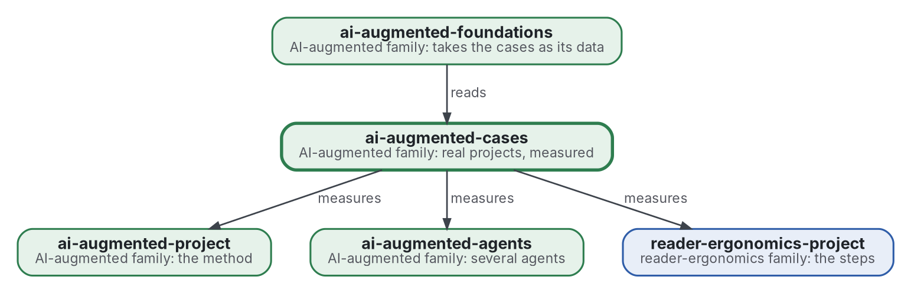

# AI-augmented cases

[](https://github.com/Tewf/ai-augmented-cases/actions/workflows/checks.yml)
[](https://tewf.github.io/ai-augmented-cases/)

The evidence of the family: one **case** per real project run with the method, saying what it cost and what it
produced. Round trips, time, where each error was caught (by a check, by the model, by the person), which decisions
reached the person and how many times the same one did. The other members say how to work; this one records what
happened when someone did.

This page in French: [README.fr.md](README.fr.md).

> **Status (2026-11-03):** version 0.1.0. Built: the first review (a first pass, 37 sources) with its baseline named,
> six principles on [a card](standard.md), five checks and 32 unit tests, the shape of a case, and two cases with a
> program that takes their counts: the day six repositories were built at once, 2026-10-29, and the night eight
> repositories had their first job, 2026-11-02. Open: there are two cases and no control, the questions that reached the
> person are counted by hand, and the program cannot count the stalls, the returns or the pushes. The name stays
> provisional. It is not an official standard, not a peer-reviewed study and not a new result.
>
> **How it is made:** with Claude, an AI assistant by Anthropic, under the maintainer's direction, the way
> reader-ergonomics was made. Corrections are welcome as issues.

## Take it

Ten minutes, without reading the review. The general form is reader-ergonomics'
[Take your own version](https://github.com/Tewf/reader-ergonomics/blob/b9732b9814c71768f722691f3c5049ec2b8ed378/README.md#take-your-own-version); here it is for writing a case.

1. **Pin the standard by commit**, so its checks do not change under you:
   `git clone https://github.com/Tewf/reader-ergonomics && git -C reader-ergonomics checkout b9732b9` (v1.19.2).
2. **Copy what you need, once:** the shape [shapes/case.md](shapes/case.md), the five checks in
   [checks/local/](checks/local/) with their helper `_cases.py` into your repository's `checks/local/`, and
   [measures.py](cases/2026-10-29-family-night/measures.py), the program that takes a day's counts from git history.
   The copies are yours; note the commit you copied from.
3. **Configure** with a `checks/config.toml` that extends the standard and copies the `[shape_conformance]` entry named
   `case` from [this one](checks/config.toml):

   ```toml
   extends = "reader-ergonomics"
   ```

4. **Write and run.** Put each case in `cases/<date>-<slug>/README.md` with a Shape line linking the shape, take its
   counts with `python3 measures.py --root DIR --day YYYY-MM-DD`, then run `python3 reader-ergonomics/checks/run.py .`
5. **Disagree** by opening an issue on this repository, with the evidence. A rule of the standard itself goes to
   reader-ergonomics' issues; a preference of your own reader goes in a reader style as an override.

## Where it sits


<details>
<summary>Graphviz source</summary>



</details>

- **It measures the members:** a case names the version of the method it was run with, by commit, and says whether
  the reasoning went through [reader-ergonomics-blueprint](https://github.com/Tewf/reader-ergonomics-blueprint), the bridge.
- **It obeys [reader-ergonomics](https://github.com/Tewf/reader-ergonomics/blob/b9732b9814c71768f722691f3c5049ec2b8ed378/standard.md)** (v1.19.2) and runs its checks in CI.
- **It links down only.** [ai-augmented-foundations](https://github.com/Tewf/ai-augmented-foundations) reads the cases; no
  case depends on it. The family's map is [ai-augmented](https://github.com/Tewf/ai-augmented).

## Scope

| | What | Why |
|---|---|---|
| in | one report per project: what was asked, what was run, what came out, what it cost | the family's claims about its method rest on these, or on nothing |
| in | the measures: round trips, time, where errors were caught, decisions that reached the person, facts written twice | what the method promises to cut must be counted |
| in | measures a program takes from a repository's history alone, so that a case can be rerun | a count by hand is a claim; a count by a program is a check |
| in | the shape of a case, so that a reader who was absent can trust it | a case written after the fact, by one of its agents, needs rules |
| out | the theory of why | [ai-augmented-foundations](https://github.com/Tewf/ai-augmented-foundations) |
| out | the method itself | [ai-augmented-project](https://github.com/Tewf/ai-augmented-project), [reader-ergonomics-project](https://github.com/Tewf/reader-ergonomics-project) |
| out | a case with a confidential subject | it stays private; only its measures may be reported |

## What the review found

The review is in [evidence/case-reports](evidence/case-reports/): 37 sources, 29 formal and 8 grey, in the five steps.

- **The field's name differs from ours.** A report written by those who took part is an **experience report**, not a case study: the community standard for case studies excludes it. A case here is an experience report with repository measures, and says so ([frame](evidence/case-reports/frame.md)).
- **A history misleads in known ways.** A repository is not a project, commits move and are rewritten, and large commits differ in intent. In the first case, 434 commits summed over seven repositories are 415 distinct, and 50 tags are 6 releases on the host.
- **No study counts what this repository asks for.** Studies of coding agents mostly measure a task, a pull request or a project; company write-ups report sessions and cost. None in the pool counts the questions that reached a person in a day.
- **Trust rests on convention.** The guidelines are built from other guidelines and experience; no study shows that a checklist makes a case more trusted. The checklist's weak item for a report from inside is triangulation.

## The baseline

The reader's checklist of Runeson 2009, 12 items, read with the experience-report criteria of ICSE 2003 and the Case Study and Repository Mining standards. A case answers each item, met or not met with a reason, and a program takes every count it can; a hand count is marked ([baseline](evidence/case-reports/baseline.md), [record 0002](decisions/0002-a-case-meets-the-readers-checklist.md)).

## Questions the review answered

- **From the history alone.** A program can take commits, files, tags and decision records per day. It cannot take questions that reached the person, nor tell a commit from a unit of work.
- **Trust.** What is quoted, counted and left out is said in the case; its shape is [shapes/case.md](shapes/case.md).
- **The first case.** [The day of 2026-10-29](cases/2026-10-29-family-night/README.md): 434 commits, 50 tags, 47 records; 16 decisions reached the person, counted by hand.
- **Comparison.** There is no control. A case is compared with the method's earlier cases, and with a contrast inside the case; the first case has no earlier one, and the second is compared with it only in kind.
- **The second case.** [The night of 2026-11-02](cases/2026-11-02-eight-first-jobs/README.md): 33 commits over eight repositories, 16 records, no tags; 6 decisions reached the person and 5 owner runs stalled and were resumed, counted by hand. The program cannot count the person's messages, the stalls, the returns or the pushes.

## The card

The [standard](standard.md) holds six principles. Three are about counting: print the caution beside the count (measured,
descriptive), distinct work over raw commits (measured, descriptive) and a hand count is marked (convention). Three are
about reporting, all convention: a participant's report is an experience report, the reader's checklist is answered, and no
model analyses the data. The shape is [shapes/case.md](shapes/case.md); the programs are in [checks/local/](checks/local/),
and [record 0003](decisions/0003-six-findings-became-principles.md) says which findings stayed findings.

## Check it

```sh
git clone https://github.com/Tewf/reader-ergonomics && git -C reader-ergonomics checkout b9732b9
python3 reader-ergonomics/checks/run.py path/to/this/repository
```

CI first runs the unit tests of the checks and of the measures program, then the same checks, on every push, and a run fails on any error
([checks.yml](https://github.com/Tewf/ai-augmented-cases/blob/master/.github/workflows/checks.yml)). Every push to
master also renders the site, [tewf.github.io/ai-augmented-cases](https://tewf.github.io/ai-augmented-cases/)
([pages.yml](https://github.com/Tewf/ai-augmented-cases/blob/master/.github/workflows/pages.yml)).

## Contents

| Part | Summary |
|---|---|
| [standard.md](standard.md) | the card: six principles with their grades and checks |
| [principles](principles/) | one file per principle: claim, grade, evidence, check, what it asks, why, limits |
| [evidence](evidence/) | the review behind this repository and its bibliography |
| [shapes](shapes/) | the shape of a case, derived from the baseline guideline, with its measures table |
| [checks](checks/) | the config, the answers, and the programs of `local/` with their tests |
| [cases](cases/) | one folder per real project: the report, the program that takes its counts, and the numbers of its run |
| [decisions](decisions/) | one record per choice that shapes this repository, each opening with the decision in one sentence |

## Licence

Code under the [Apache License 2.0](LICENSE); prose under [CC BY 4.0](LICENSES/CC-BY-4.0.txt). Reuse it as you wish,
with credit to this repository; [CITATION.cff](CITATION.cff) gives a citation if you need one.
